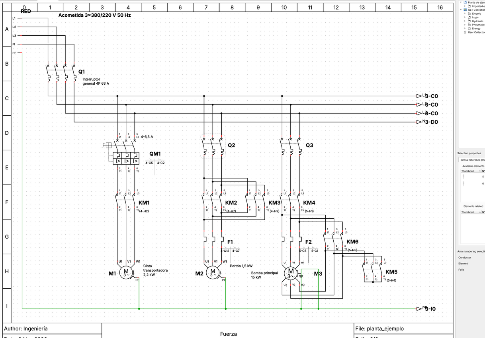
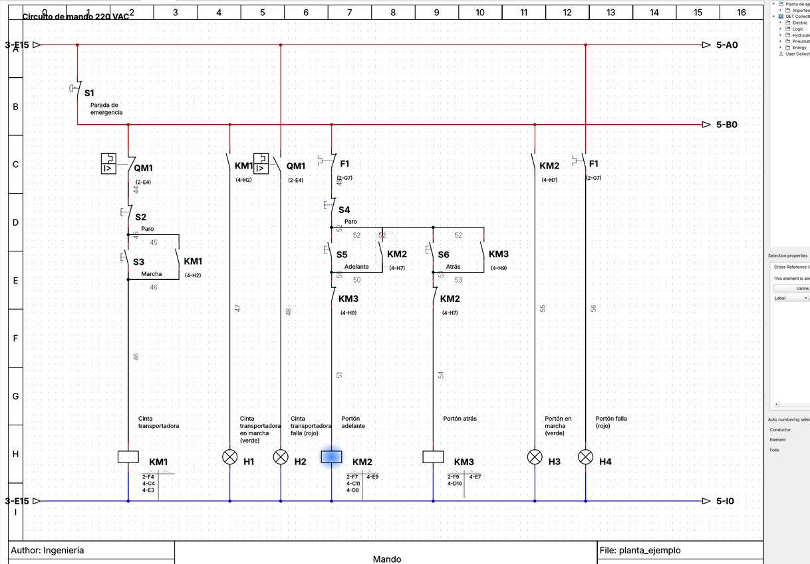
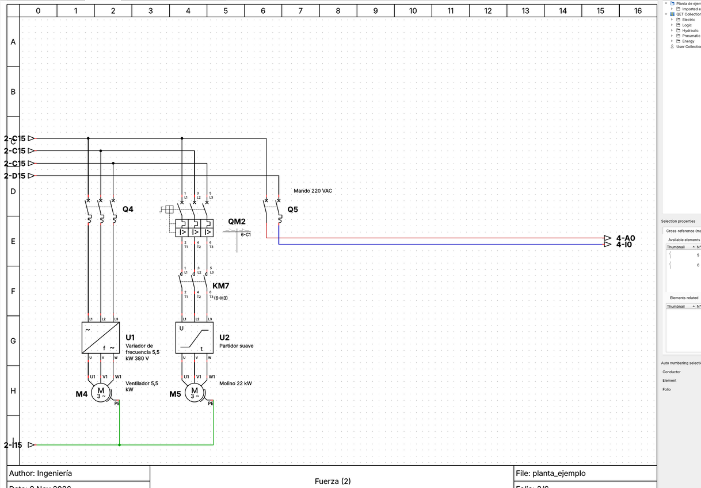
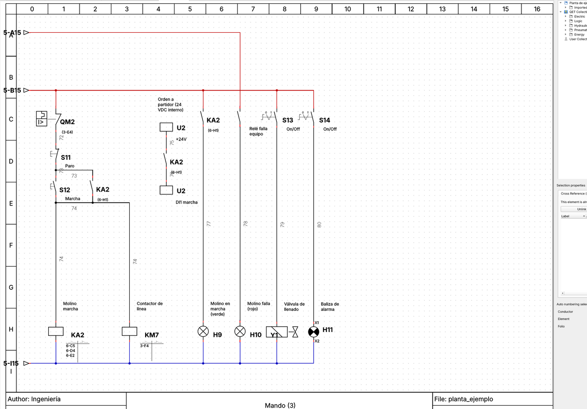

# qet-autogen — Planos eléctricos y de control automáticos para QElectroTech

Describes **qué** quieres controlar en un archivo YAML (motores, tipo de arranque,
protecciones, pilotos, válvulas...) y el programa genera un proyecto **QElectroTech
(`.qet`)** con:

- **Portada e índice** de folios con los datos del proyecto.
- **Esquema de fuerza** (multifilar): acometida, interruptor general, barras L1-L2-L3-N-PE,
  guardamotor o disyuntor (+ relé térmico), contactores, variador o partidor suave y motor.
- **Esquema de mando** (en escalera): parada de emergencia, marcha/paro con
  autorretención, enclavamientos, temporizador estrella-triángulo, orden de marcha a
  variadores/partidores (relé KA → entrada digital), pilotos de marcha y falla.
- **Referencias cruzadas** reales de QElectroTech: cada bobina sabe dónde están sus
  contactos (de fuerza y auxiliares), y los contactos muestran dónde está su bobina.
- **Flechas de continuación** enlazadas entre folios (los rieles L / N y las barras siguen en
  el folio siguiente cuando falta espacio).
- **Numeración de conductores** por equipotencial (todos los cables del mismo nodo llevan el
  mismo número; barras y rieles se llaman L1, L2, L3, N, PE, L, L', N).
- **Lista de materiales** en CSV (se abre directamente en Excel).

Todos los archivos generados se abren y se pueden editar en QElectroTech 0.8/0.9 como
cualquier proyecto hecho a mano.

| Fuerza | Mando |
|---|---|
|  |  |
|  |  |

## Instalación

Requiere Python 3.10 o superior y PyYAML:

```bash
pip install pyyaml
```

No hace falta tener QElectroTech instalado para generar los archivos: los símbolos que se
usan vienen incluidos en `qetgen/elementos/` (biblioteca oficial, licencia CC-BY 3.0).

## Uso

```bash
cd qet-autogen
python -m qetgen ejemplos/planta_ejemplo.yaml -o salida/planta.qet
```

Genera `salida/planta.qet` y `salida/planta_materiales.csv`. Abre el `.qet` con QElectroTech.

## Usar un plano de la empresa como plantilla (estilo PAT)

Si le indicas un proyecto `.qet` de referencia, el generador toma de él:

- el **cajetín** (con sus logos) y el **tamaño de folio** (p.ej. 20×10 cuadros de 61×80 px);
  el título de cada folio se escribe en el campo `%filename` del cajetín y el número en `%folio`;
- la **portada** (copiada tal cual, con reemplazo de textos) y otros folios que pidas copiar
  (p.ej. *DATOS TÉCNICOS DEL EQUIPO*);
- la **configuración del proyecto** (conductores, referencias cruzadas, reportes);
- los **símbolos incrustados** en ese proyecto (tienen prioridad sobre la biblioteca estándar).

Además genera el **índice con la tabla nativa** de QElectroTech (se actualiza sola si agregas
folios) y aplica el **estilo de rotulado** de la empresa:

| | Estilo `simple` | Estilo `pat` |
|---|---|---|
| Etiquetas | Q1, QM1, KM1, S1, H1 | TM-01, GM-01, KM-01, PB-01, LP-01, RT-01, VF-01, EV-01 |
| Fases | L1, L2, L3, N, PE | R, S, T, N, TP |
| Conductores de fuerza | 1, 2, 3... | R-000, S-001, T-002, N-003, TP000 (la etapa avanza en cada equipo) |
| Conductores de mando | 1, 2, 3... | A-101, A-102... |
| Descripciones | texto simple | negrita cursiva en mayúsculas; capacidades enmarcadas (4xC63A) |

```yaml
plantilla: ../plantillas/PAT-1111-PLN-300-0.qet   # relativa al YAML
estilo: pat
reemplazos_portada:            # se aplican a la portada y a los folios copiados
  SISTEMA DE PALETIZADO DE SALMON: TABLERO DE FUERZA Y CONTROL
  ABRIL 2025: NOV 2026
copiar_folios: [DATOS TÉCNICOS DEL EQUIPO]
prefijos: {S: PB, H: LP}       # opcional: cambia cualquier prefijo de etiqueta
alimentacion:
  interruptor_general:
    descripcion: Interruptor termomagnético principal
    capacidad: 4xC63A
    icc: "Icc:18kA"
```

Ejemplo completo: [`ejemplos/planta_pat.yaml`](ejemplos/planta_pat.yaml). La plantilla va en
`plantillas/` y **no se sube al repositorio** (`.gitignore`), porque contiene logos y datos de
clientes.

## Formato de la especificación

```yaml
proyecto:
  titulo: Planta de ejemplo
  autor: Ingeniería
  planta: Planta 1
  ubicacion: Tablero TG-01

alimentacion:
  tension: 3x380/220 V 50 Hz
  tension_mando: 220 VAC
  interruptor_general: Interruptor general 4P 63 A

parada_emergencia: true
portada: true            # folio 1 con datos e índice
numerar_fuerza: false    # mostrar o no los números de cable en los folios de fuerza

cargas:
  - tipo: motor
    tag: M1
    descripcion: Cinta transportadora
    potencia: 2,2 kW
    arranque: directo           # directo | inversor | estrella_triangulo | variador | partidor_suave
    proteccion: guardamotor     # guardamotor | disyuntor_termico | disyuntor
    ajuste: 4-6,3 A
    mando: pulsadores           # pulsadores | selector
    piloto_marcha: true
    piloto_falla: true

  - tipo: motor
    tag: M4
    descripcion: Ventilador
    arranque: variador          # protección por defecto: disyuntor
    modelo: 5,5 kW 380 V
    contactor_linea: false      # por defecto: false en variador, true en partidor suave

  - tipo: electrovalvula        # electrovalvula | lampara | baliza | rele
    descripcion: Válvula de llenado
    mando: selector             # selector | pulsador
```

Ver el ejemplo completo en [`ejemplos/planta_ejemplo.yaml`](ejemplos/planta_ejemplo.yaml)
y su resultado en `ejemplos/planta_ejemplo.qet`.

## Estructura del código

| Archivo | Qué hace |
|---|---|
| `qetgen/library.py` | Lee los símbolos `.elmt` (bornes, tipo maestro/esclavo, posición de etiqueta). |
| `qetgen/symbols.py` | Alias en español → símbolo de la biblioteca. **Aquí se cambian los símbolos.** |
| `herramientas/crear_simbolos.py` | Dibuja los símbolos propios (variador, partidor suave, bornes de equipo). |
| `qetgen/project.py` | Modelo del proyecto (folios, elementos, conductores) y escritura del XML `.qet`. |
| `qetgen/circuits.py` | Generadores de fuerza y mando (arranque directo, inversor, estrella-triángulo...). |
| `qetgen/bom.py` | Lista de materiales CSV. |
| `tests/` | Verifica que cada conductor apunte a bornes válidos y que los trazados sean coherentes. |

También se puede usar como biblioteca para dibujar circuitos propios:

```python
from qetgen import Project

p = Project("Prueba", author="Yo")
f = p.folio("Mando")
s1 = f.add("pulsador_na", 200, 150, "S1")
km = f.add("bobina", 200, 300, "KM1")
aux = f.add("contacto_na", 270, 150, "KM1")
aux.link(km)                      # referencia cruzada bobina ↔ contacto
f.wire(s1.bottom(), km.top())     # trazado automático
f.wire(s1.top(), aux.top(), y=120)  # trazado por la cota y=120
p.autonumber()
p.save("prueba.qet")
```

## Detalles técnicos del formato `.qet`

- En la instancia, QElectroTech identifica cada borne por su punto de anclaje
  **desplazado 4 px hacia el interior del símbolo** respecto a la definición; si no
  coincide, el conductor no se carga.
- Los trazados se guardan como segmentos relativos; si no suman exactamente la distancia
  entre los dos bornes, QElectroTech los descarta y traza automáticamente.
- Los símbolos usados se incrustan en la colección del proyecto (`embed://import/...`),
  así el `.qet` se abre en cualquier PC.

## Próximos pasos

- Ajustar el estilo (cajetín, numeración, símbolos, distribución) a los planos de referencia.
- Más tipos de arranque/cargas: Dahlander, monofásicos, entradas/salidas de PLC.
- Borneras con numeración y folio de borneras.
